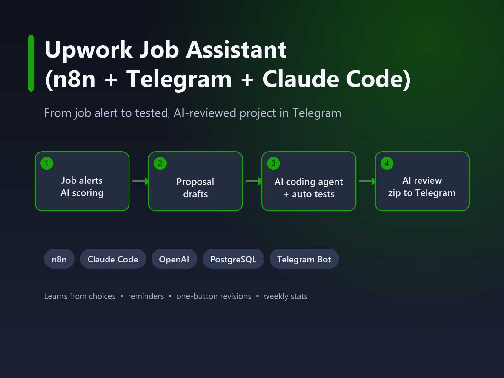
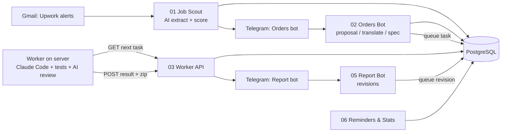

# Upwork AI Assistant — n8n + Telegram + Claude Code

A personal AI assistant for freelancing, built with **n8n**, **Telegram**, **PostgreSQL**, **OpenAI** and **Claude Code**.
It turns Upwork job alerts into a full pipeline: find and score jobs → draft proposals → track client messages → build the project with an AI coding agent → run tests and an AI review → deliver a zip in Telegram.



## Features

- **Job scout** — reads Upwork job-alert emails from Gmail, extracts every job with AI, translates it and scores it 0–10 against the freelancer profile.
- **Learns from decisions** — jobs you take or skip are fed back into scoring, so recommendations improve over time.
- **Proposal drafts** — one button writes a short, specific cover letter (with a translation), a work plan, price and time estimate, and mentions the most relevant portfolio project.
- **Client messages** — new messages and offers are detected, translated, explained, and a reply is suggested.
- **Task queue → AI coding agent** — when a job is agreed, a task spec is generated and queued; a worker on a server runs Claude Code headless to build the project and write automated tests.
- **Second-AI review** — a separate review pass checks the result against the spec, fixes small issues and gives a readiness score.
- **One-button revisions** — client change requests go back to the same project folder, with tests re-run.
- **Reminders & weekly stats** — reminder if a client waits 2+ hours; Sunday summary of jobs, replies, projects and tips.

## Architecture



## Repository structure

| Path | What it is |
|---|---|
| `workflows/01-job-scout.json` | Gmail trigger → AI extraction & scoring → Postgres → Telegram job cards |
| `workflows/02-orders-bot.json` | Telegram bot: proposals, skip, translator, "agree" → task spec & queue |
| `workflows/03-worker-api.json` | Webhooks the worker uses to take tasks and return results |
| `workflows/05-report-bot.json` | Telegram report bot: "revise" button → revision task |
| `workflows/06-reminders-stats.json` | Reminders and weekly statistics |
| `worker/worker.js` | Node.js worker that runs Claude Code headless, zips and reports results |
| `worker/upwork-worker.service` | systemd unit to run the worker 24/7 |

## Setup

1. **n8n** (self-hosted or cloud): import the JSON files from `workflows/`.
2. Create credentials in n8n: *Gmail*, *Postgres*, *OpenAI*, and two *Telegram* bots (Orders and Report).
3. Replace placeholders in the workflows:
   - `YOUR_TELEGRAM_CHAT_ID` — your Telegram user id
   - `YOUR_WORKER_KEY` — a long random string shared with the worker
4. Tables are created automatically on first run (`upwork_jobs`, `upwork_messages`, `upwork_tasks`).
5. **Worker** on a Linux server (Node.js 18+, `zip`, Claude Code installed and logged in):
   ```bash
   sudo adduser --disabled-password --gecos "" upwork
   sudo -u upwork mkdir -p /home/upwork/upwork-worker
   sudo cp worker/worker.js /home/upwork/upwork-worker/
   sudo cp worker/config.example.json /home/upwork/upwork-worker/config.json   # then edit it
   sudo cp worker/upwork-worker.service /etc/systemd/system/
   sudo systemctl enable --now upwork-worker
   ```
6. Test the worker end-to-end without the queue: `node worker.js --selftest`.

## Security notes

- The worker runs Claude Code on tasks derived from **external client messages**. It runs as a separate unprivileged user, only inside the project folder, with an allow-list of tools (npm, node, python, pip, file edits) and a deny-list (curl, wget, ssh, shell escapes, `git push`, `rm`).
- A human confirms every task with a button before it is queued, and reviews the result before delivery.
- Proposals and client messages are **always sent manually** by the freelancer — nothing is posted to Upwork automatically.

## License

MIT
